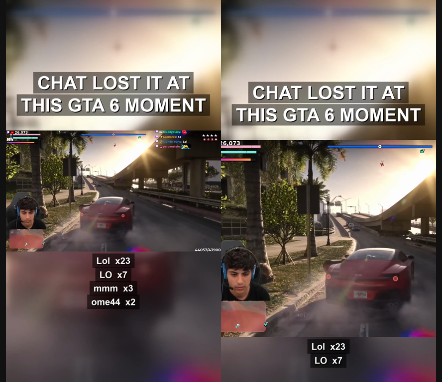
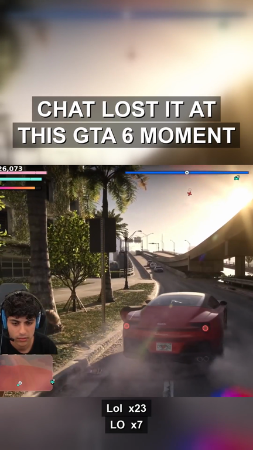

# HypeCut

**A clip-detection node for [Overlap](https://www.overlap.ai) that uses live audience reaction instead of content analysis.**

Built against Overlap's node model: `Twitch Live → Chat Spike → Reframe → Style Video → Post to Social`.
The last three nodes already exist. This is the first two.

---

## What it produces



Both frames were generated by the same code from the same source. The only difference is
three parameters.

**Left** — the first automated attempt: letterboxed at native scale, most of the canvas
wasted on blur, the facecam a postage stamp. **Right** — after the framing was measured by
hand against a reference clip and ported back (`videoScale 1.63`, `videoOffsetY 0.125`,
`cropAnchorX 0.12`).

The moment itself was chosen with **no video analysis whatsoever**. Twenty-three people
typed "Lol" inside four seconds on stableronaldo's GTA 6 stream, and that was the entire
signal. The clip was then cut from a rolling buffer, reframed, captioned and written to
disk without anyone watching.




---

## Why

Overlap's `Find Clips` node reads a recording against a prompt you write. For a podcast that is
exactly right — the words *are* the moment. For gameplay it is structurally wrong:

- there is often no speech worth transcribing,
- the audio is engine noise, sirens and gunfire,
- and "good moment" is defined by **audience reaction**, not by content.

Overlap's own GTA 6 guide suggests the prompt *"reactions and chases only; skip story cutscenes"* —
straining to describe in English what chat hands you for free. On a 44,000-viewer stream, forty-four
thousand people are already labelling the footage in real time, for nothing.

**Why this is a margin problem, not a feature request.** Overlap bills $0.50–$2.50 CPM on *delivered
views* and explicitly absorbs the downside: "nothing charged for reach that did not land." Every clip
that flops costs GPU time and earns zero. Clip-selection precision is not a UX nicety for them — it
is gross margin. A detector with a 50% false-positive rate makes that worse. One that doesn't is a
direct margin improvement.

**And the timing gap is theirs to close.** Their streamers page says the source is "the VODs you
already keep." Their newly shipped Twitch support promises clips "in real time... no more waiting
until the stream ends." The flagship content for the biggest game launch in history still assumes the
VOD workflow. During launch week, when attention is highest, a VOD pipeline posts hours late.

---

## The three decisions that matter

### 1. Compare like with like

The first version compared unique chatters in a 4-second window against
unique-chatters-per-second over 180 seconds. That is invalid, and subtly so.

**Uniqueness saturates over long windows.** Chat is not a stream of strangers — a pool of regulars
talks repeatedly. So 200 distinct people over three minutes reads as 1.1/sec, while 15 distinct
people in four seconds reads as 3.75/sec. The ratio reports a 3.4x spike *when nothing has happened*.

On perfectly steady synthetic chat, that method reports **3.83x** against a fire threshold of 2.6 —
it fires continuously on nothing:

```
v1 ratio on steady chat: 3.83x   (fireRatio was 2.6)
v2 on steady chat:       0 spikes from 4,499 messages
```

The fix: slice the baseline into same-sized 4-second buckets and compare a bucket against the
**distribution** of buckets, using median and MAD (`1.4826 × MAD` as a consistent estimator of σ).
Median, because chat has fat tails and one earlier spike must not drag the baseline.

### 2. Count unique chatters, not messages

One person firing forty messages is not a moment. Four hundred people typing once is. Message rate is
trivially gamed by spam, bots and copypasta; unique-sender rate is not.

### 3. Chat reacts *after* the event

Encode latency, network, and human reaction time mean chat peaks roughly 3–5 seconds after the thing
happened on screen. **Clip from the chat peak and you land on the laughter and miss the joke.** The
estimated on-screen onset is `peak − reactionLag`, and the clip window is built backwards from there.
This is the most common way naive chat-clippers produce unusable clips.

---

## The reaction-shape gate

A spike says chat got louder. It does not say why. Chat gets louder for a YouTube outage, a raid, a
giveaway, the streamer asking a question, or the topic turning — none of which is clippable. In the
first live run roughly half of all detections were conversation:

```
ohnepixel "SHOCK":  "bye yt" / "Is youtube back up?" / "FROM THE TRAILER"
jynxzi    "FUNNY":  "find god" / "how does he have 60fps?" / "Lucia is packing"
```

### The lexicon was the wrong primitive

The first gate weighted a lexicon highest — matching chat against KEKW, LOL, POG, MonkaS. Measured
against **6,095 messages of real GTA 6 chat across 8 channels**, that turned out to be backwards:

| window | repetition | lowDiversity | reactionWords | truth |
| ------ | ---------: | -----------: | ------------: | ----- |
| 86 people typing `heist`        | **0.877** | **0.891** | 0.008 | real moment |
| `NOOO / SAJ / SAJ / NOOOOO`     | **0.521** | **0.723** | 0.125 | real moment |
| `WTF / LOL / LO / LOL`          | **0.389** | **0.445** | 0.379 | real moment |
| `@M0hamdQ LOL / ciao bello / mhm mhm gotta close chat` | 0.250 | 0.200 | **0.500** | conversation |
| `dansi / Me / this time / it looked cooler without camo` | 0.227 | 0.185 | 0.318 | conversation |
| `Hi Lacy / sob / stop / ps5 / XBOX`  | 0.207 | 0.164 | 0.138 | giveaway spam |

The best detection in the entire run — 86 people typing **"heist"** in unison — scored 0.008 on the
lexicon. The worst false positive scored 0.500, because one chatter wrote "@M0hamdQ LOL".

**The real signal is convergence**: a mass reaction makes hundreds of people type the same short
thing at the same time. *What* they type is irrelevant. A lexicon only catches reactions whose
vocabulary you anticipated; convergence is vocabulary-independent, so it is also **language- and
game-independent** — it works unchanged on Spanish chat, and on a game whose slang does not exist
yet. The lexicon still earns its place naming the moment, just not detecting it.

### Result after reweighting

```
6,095 messages · 8 channels · 9.0 min
candidates 16 → accepted 4 · rejected 12   (gate removed 75%)

 71/100  shape 0.67  z=17.76  86 chatters  unclear   lacy            "heist"
 65/100  shape 0.52  z=67     67 chatters  fail      stableronaldo   "NOOO / SAJ"
 58/100  shape 0.43  z= 7.64  46 chatters  funny     stableronaldo   "WTF / LOL"
 49/100  shape 0.45  z= 5.73  46 chatters  funny     stableronaldo   "LOL / Yooo"
```

All four survivors are genuine mass reactions. Every conversation and giveaway-spam false positive
was removed. Two borderline moments were also dropped, sitting just under the 0.30 gate — **this
deliberately favours precision over recall**, because under CPM billing a false positive costs render
time and earns nothing, while a missed moment costs only opportunity. On a six-hour stream there is
no shortage of candidates; there is a shortage of good ones.

Note the top detection is labelled `unclear`, and that is the honest answer: detection is
vocabulary-independent but *captioning* is not. A moment chat names "heist" needs either an LLM pass
over the window text or a vision pass over the frames before `Style Video` can caption it. That is a
real limitation, not a rounding error.

## Layout

```
src/lexicon.mjs    shared chat vocabulary (classifier + gate read from one source)
src/chat.mjs       anonymous Twitch chat reader — zero credentials
src/detector.mjs   bucketed median/MAD baseline, hysteresis spike tracking, onset estimation
src/shape.mjs      reaction-shape gate
src/classify.mjs   moment type (funny/shock/hype/fail/scary) + ranking score
src/render.mjs     cut the detected window and reframe it 9:16 (ffmpeg)
record.mjs         capture chat to JSONL
replay.mjs         deterministic offline replay for threshold tuning
tests/             numeric proof of the baseline fix and the gate separation
```

## Running it

```bash
npm test                                      # proves the math
node live.mjs ohnepixel,jynxzi 170            # watch it detect on live streams
node record.mjs ohnepixel,stableronaldo 9     # capture chat for tuning
node replay.mjs data/chat-*.jsonl --verbose   # deterministic replay
node clip.mjs source.mp4 15 30 out/clip.mp4    # cut + 9:16 reframe
```

`renderClip` takes a local file **or an HLS manifest URL**, so the same stage serves a
recorded VOD and a live stream unchanged.

### The framing numbers came from editing one clip by hand

The first automated version letterboxed the 16:9 frame at native scale over a blurred
background. It was technically correct and visually dead — the video occupied about a third
of the canvas and the rest was blur. So one clip was edited by hand in Edits against a
reference clip that had actually gone viral, and the settings that made it work were
measured and ported back:

| parameter | value | why |
| --------- | ----- | --- |
| `videoScale` | `1.63` | video is 163% of canvas **width**, overflowing so the sides crop. At 1.0 most of the frame is wasted blur. |
| `videoOffsetY` | `0.125` | pushes the video down an eighth of the canvas, clearing a band for the headline instead of colliding with it. |
| `cropAnchorX` | per channel | which side survives the crop. A facecam in a bottom corner is the most valuable pixels in a reaction clip, and a centred crop throws it away. `stableronaldo` is bottom-left, so `0.12`. |

The headline is a short statement of what happened, not a label — `CHAT LOST IT AT THIS GTA 6
MOMENT`, not `CHAT LOST IT`. `layoutHeadline` wraps it and shrinks the font to fit the band.

**The long-word rule** is the non-obvious one. `drawtext` does not wrap, so wrapping happens
in code — but the real failure is a single word wider than the canvas. The first headline
tried by hand was *"stableronaldo's chat LOST IT during GTA 6"*, which broke as
`STABLERONA / LDO'S CHAT`. Reference clips get away with this only because handles like
"N3on" are short. A word that cannot fit on its own line means the headline must be
**rewritten, not squeezed**, so `layoutHeadline` returns an error rather than silently
shipping a sliced word.

Measured: a 30s clip renders in about 4.4s, roughly 7x realtime, so a six-hour stream
yielding 50 clips costs around four minutes of render.

## Notes on rights

Overlap's own GTA 6 guide is blunt that monetized GTA content is "tolerated, not licensed," and flags
story spoilers and in-game radio music (Content ID) as the main takedown risks. Reading public chat
is uncontroversial; capturing and reposting footage is not. A spoiler-and-music guardrail belongs in
this pipeline before anything it produces gets published, and is the next thing to build.
